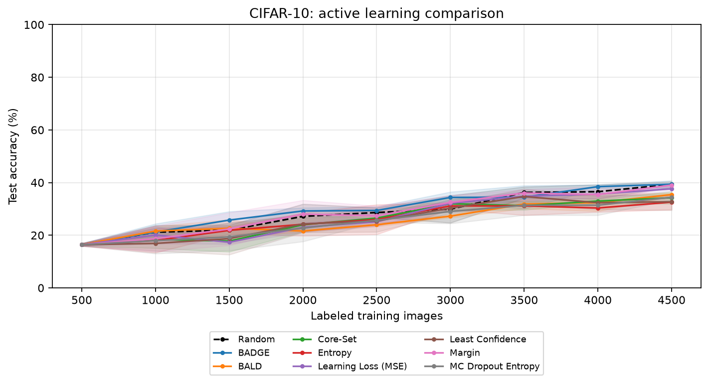

# Active Learning Benchmark for Computer Vision

This project compares active learning strategies for computer vision tasks.
The question is how acquisition strategies affect classification accuracy under
the same labeling and training budget.

## Goal

Build a reproducible pipeline for:
- dataset preparation
- initial random sampling
- model training
- active learning query strategies
- evaluation
- reporting

## Benchmark strategies

1. Random Sampling
2. Least Confidence
3. Margin Sampling
4. Entropy Sampling
5. MC Dropout Entropy
6. BALD
7. Core-Set / Diversity Sampling
8. BADGE
9. Learning Loss (simplified MSE-based loss prediction)

## Running experiments

Use Python 3.12 or newer. From the repository root:

```bash
python -m pip install -e ".[dev]"
python -m pytest -q
python scripts/run_experiment.py --config configs/smoke.yaml --device cpu
```

The smoke configuration runs all nine strategies on small synthetic datasets. It
checks the pipeline without downloading CIFAR-10; its accuracy is not a benchmark
result.

For the real benchmark:

```bash
python scripts/run_experiment.py --config configs/benchmark.yaml --device cuda
```

Use `--device cpu` if CUDA is unavailable. Omit `--strategy` and `--seed` to run all
combinations from the YAML, or override them for a single run:

```bash
python scripts/run_experiment.py --config configs/benchmark.yaml --strategy entropy --seed 1 --device cpu
```

The default protocol uses CIFAR-10, seeds ('1', '2', '3'), an initial pool of 500 images,
eight acquisitions of 500 images, and nine measurements from 500 to 4,500 labeled
images. Every round trains a new model for five epochs, a deliberately limited
compute budget. All nine strategies use the same SimpleCNN backbone with dropout
`0.3`, the same SGD settings, and the same initial split for a given seed. More
seeds can be added to `seeds` before running experiments.

Learning Loss preserves the milestone implementation: a separate module predicts
per-example classification losses using MSE and detached classifier features.
This is a simplified baseline, not a reproduction of the paper's ranking-loss
training procedure. VAAL and the unfinished TypiClust implementation are not part
of this nine-strategy protocol.

Each run creates `reports/benchmark_v1/<strategy>/seed_<seed>/` with `metrics.csv`,
`config.json`, `selected_indices.json`, and `environment.json`. Results are saved
after every completed round. Existing run directories are never overwritten;
choose a new `output_dir` to rerun the same strategy and seed. The same applies to
`reports/smoke/` when rerunning the smoke configuration.

CSV rounds are zero-based. `query_seconds` measures the acquisition that produced
the current round's labeled pool, including feature extraction and selection. It
is zero for the initial pool. Training time excludes model construction and
evaluation. CUDA timings are synchronized.

Reproducibility is targeted within the same software/hardware environment, not
bit-for-bit equality between CPU and CUDA or between PyTorch versions. The
environment file records installed package versions, device, thread count, Git
commit, and working-tree state, excluding the configured output directory.

## Summarizing results

After completing the runs, generate the comparison:

```bash
python scripts/summarize_results.py --input-dir reports/benchmark_v1
```

This creates `reports/benchmark_v1/summary/` with:

- `learning_curves.png`: test accuracy versus the labeled pool size.
- `summary.csv`: final accuracy and total training/query time for each strategy.
- `summary.md`: a readable table and the plot, ready to open on GitHub.

With multiple seeds, the plot shows the mean and one sample standard deviation;
with one seed, no variability estimate is shown. CSV accuracy values are fractions
in `[0, 1]`, while the plot and Markdown table display percentages. Timing values
are seconds per full run, averaged across seeds; use the same hardware when
comparing timings.

The reporting script reads only the new `<strategy>/seed_*/metrics.csv` layout.
It rejects unfinished runs, mismatched protocols/devices, or different seed sets
between strategies. You can regenerate derived reports without changing raw run
files. For a quick offline check, use `--input-dir reports/smoke` after running the
smoke configuration.

The older milestone scripts, tables, and plots are development history. Some
precede the corrected pool updates; they are excluded from the unified comparison.
Numerical conclusions should be based on freshly generated benchmark results.

## Method references

- [MC Dropout / BALD: Deep Bayesian Active Learning with Image Data](https://arxiv.org/abs/1703.02910)
- [Core-Set: Active Learning for Convolutional Neural Networks](https://arxiv.org/abs/1708.00489)
- [BADGE: Deep Batch Active Learning by Diverse, Uncertain Gradient Lower Bounds](https://arxiv.org/abs/1906.03671)
- [Learning Loss for Active Learning](https://arxiv.org/abs/1905.03677) (the implementation here uses the simplified MSE objective described above)

## Project structure

- `data/` — datasets and splits
- `src/alcv/` — source code
- `configs/` — experiment configs
- `models/` — trained models
- `reports/` — results, figures, tables
- `scripts/` — runnable scripts
  
## Results

I compared all nine strategies on CIFAR-10 using seeds 1, 2 and 3.
The labeled pool grew from 500 to 4,500 images. Each round started
with a new model trained for five epochs.



Random sampling reached 39.33% final test accuracy, compared with
39.38% for BADGE and 39.05% for margin sampling. BADGE's small
advantage over random sampling was smaller than the variation
between seeds, while its acquisition step took considerably longer.

Under this training budget, the more complex strategies did not
provide a clear improvement in final accuracy over random sampling.
These results are specific to the small CNN and training settings
used here.

The shaded areas show one sample standard deviation across the
three seeds.

[Full results and timings](reports/benchmark_v1/summary/summary.md)
