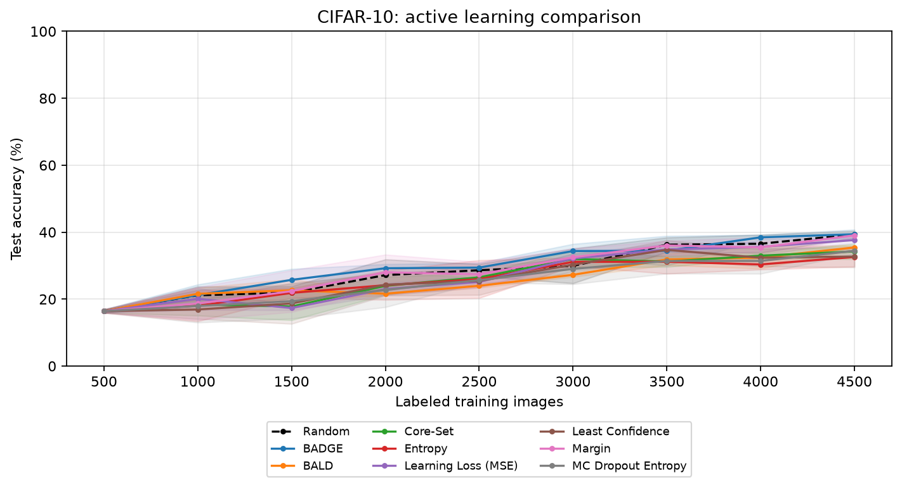

# Benchmark summary

Dataset: cifar10. Seeds: [1, 2, 3].
Model: simple_cnn_dropout. Epochs per round: 5.

| Strategy | Seeds | Final labels | Test accuracy | Train (s) | Query (s) |
| --- | ---: | ---: | ---: | ---: | ---: |
| Random | 3 | 4500 | 39.33% +/- 1.05 pp | 76.72 | 0.05 |
| BADGE | 3 | 4500 | 39.38% +/- 1.37 pp | 67.52 | 1079.01 |
| BALD | 3 | 4500 | 35.44% +/- 0.68 pp | 70.15 | 910.68 |
| Core-Set | 3 | 4500 | 34.24% +/- 2.31 pp | 69.54 | 186.87 |
| Entropy | 3 | 4500 | 32.58% +/- 2.85 pp | 74.46 | 141.10 |
| Learning Loss (MSE) | 3 | 4500 | 37.63% +/- 1.01 pp | 70.46 | 127.31 |
| Least Confidence | 3 | 4500 | 32.72% +/- 3.23 pp | 76.00 | 142.91 |
| Margin | 3 | 4500 | 39.05% +/- 0.58 pp | 75.88 | 141.89 |
| MC Dropout Entropy | 3 | 4500 | 34.42% +/- 0.89 pp | 74.24 | 966.85 |

