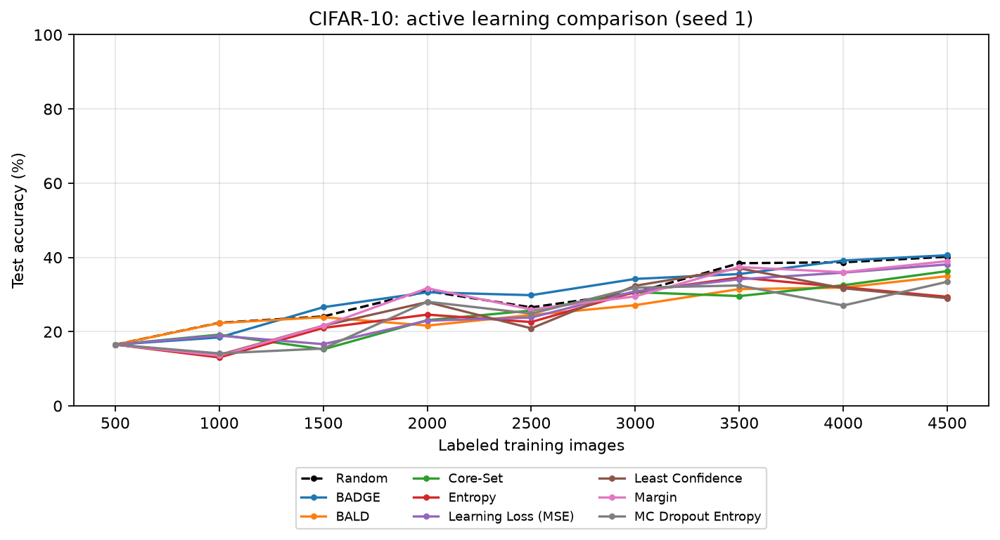

# Benchmark summary

Dataset: cifar10. Seeds: [1].
Model: simple_cnn_dropout. Epochs per round: 5.

| Strategy | Seeds | Final labels | Test accuracy | Train (s) | Query (s) |
| --- | ---: | ---: | ---: | ---: | ---: |
| Random | 1 | 4500 | 40.19% | 88.70 | 0.06 |
| BADGE | 1 | 4500 | 40.59% | 65.31 | 1046.37 |
| BALD | 1 | 4500 | 34.95% | 65.56 | 874.38 |
| Core-Set | 1 | 4500 | 36.31% | 66.06 | 172.52 |
| Entropy | 1 | 4500 | 29.39% | 87.57 | 166.21 |
| Learning Loss (MSE) | 1 | 4500 | 38.12% | 68.59 | 122.73 |
| Least Confidence | 1 | 4500 | 29.03% | 87.18 | 163.90 |
| Margin | 1 | 4500 | 39.00% | 87.13 | 163.22 |
| MC Dropout Entropy | 1 | 4500 | 33.44% | 87.91 | 1152.78 |

With multiple seeds, accuracy is mean +/- sample standard deviation across seeds. With one seed, variability is not estimated.
Training and query times are totals per run, averaged across seeds; compare timings on the same hardware.

