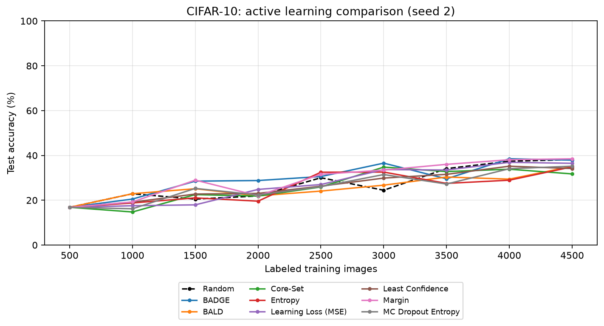

# Benchmark summary

Dataset: cifar10. Seeds: [2].
Model: simple_cnn_dropout. Epochs per round: 5.

| Strategy | Seeds | Final labels | Test accuracy | Train (s) | Query (s) |
| --- | ---: | ---: | ---: | ---: | ---: |
| Random | 1 | 4500 | 38.16% | 66.80 | 0.04 |
| BADGE | 1 | 4500 | 37.89% | 70.67 | 1107.39 |
| BALD | 1 | 4500 | 35.15% | 79.53 | 995.80 |
| Core-Set | 1 | 4500 | 31.74% | 75.81 | 212.53 |
| Entropy | 1 | 4500 | 34.89% | 66.05 | 126.53 |
| Learning Loss (MSE) | 1 | 4500 | 36.47% | 73.25 | 133.08 |
| Least Confidence | 1 | 4500 | 34.13% | 66.86 | 126.93 |
| Margin | 1 | 4500 | 38.49% | 66.83 | 126.64 |
| MC Dropout Entropy | 1 | 4500 | 35.19% | 65.84 | 863.01 |

