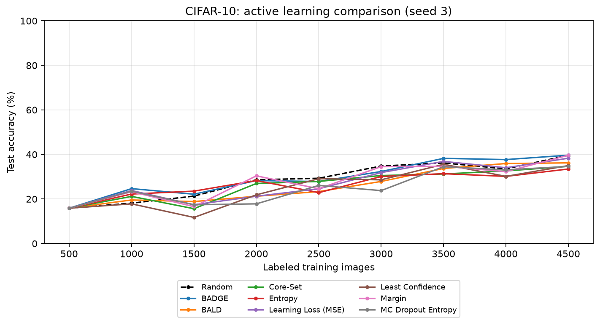

# Benchmark summary

Dataset: cifar10. Seeds: [3].
Model: simple_cnn_dropout. Epochs per round: 5.

| Strategy | Seeds | Final labels | Test accuracy | Train (s) | Query (s) |
| --- | ---: | ---: | ---: | ---: | ---: |
| Random | 1 | 4500 | 39.63% | 74.67 | 0.05 |
| BADGE | 1 | 4500 | 39.67% | 66.58 | 1083.26 |
| BALD | 1 | 4500 | 36.22% | 65.36 | 861.86 |
| Core-Set | 1 | 4500 | 34.66% | 66.74 | 175.55 |
| Entropy | 1 | 4500 | 33.46% | 69.75 | 130.57 |
| Learning Loss (MSE) | 1 | 4500 | 38.31% | 69.55 | 126.12 |
| Least Confidence | 1 | 4500 | 35.00% | 73.96 | 137.88 |
| Margin | 1 | 4500 | 39.65% | 73.67 | 135.82 |
| MC Dropout Entropy | 1 | 4500 | 34.63% | 68.95 | 884.75 |

With multiple seeds, accuracy is mean +/- sample standard deviation across seeds. With one seed, variability is not estimated.
Training and query times are totals per run, averaged across seeds; compare timings on the same hardware.

